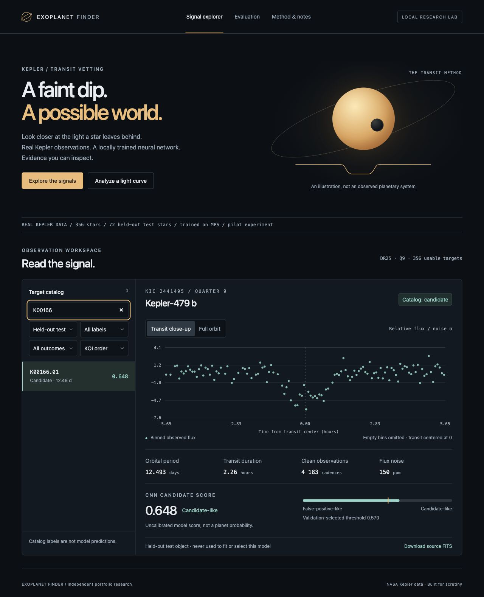
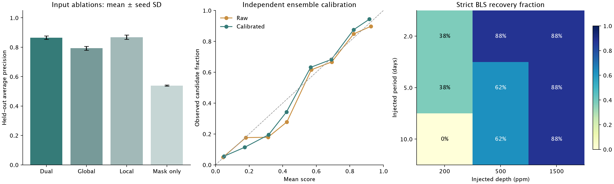
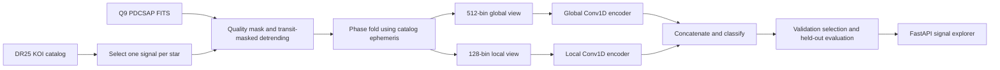
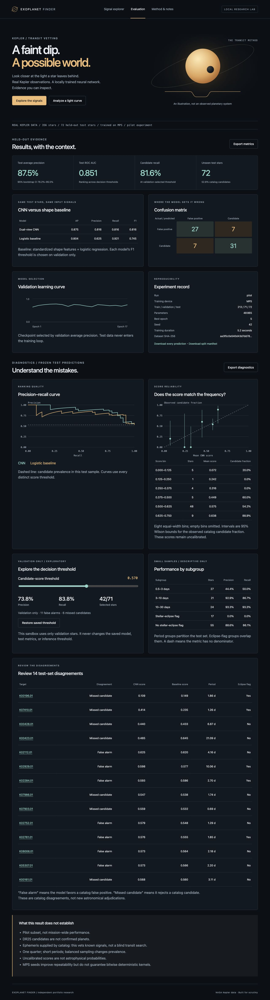

# Exoplanet Finder

**From a star’s faint dip to an inspectable machine-learning prediction.**

[](https://github.com/mehdi-bakkali/exoplanet-finder/actions/workflows/tests.yml)


A complete local research workflow for vetting NASA Kepler transit signals: real photometry, a compact dual-view CNN, a baseline comparison, reproducible evaluation, and an interactive analysis app. Runs on Apple silicon through MPS and on CPU.

[Quick start](#quick-start) · [Results](#measured-results) · [Model card](docs/MODEL_CARD.md) · [Learning guide](docs/LEARNING.md) · [Roadmap](docs/PLAN.md)



## What you can do

- **Inspect real observations.** Search 356 Kepler targets, switch between full-orbit and transit views, and trace each signal to its source FITS file.
- **Challenge the model.** Compare the CNN with logistic regression, inspect precision–recall and reliability plots, and review all 14 held-out catalog disagreements.
- **Explore decisions.** Adjust a validation-only threshold to see the precision/recall trade-off and follow-up load.
- **Analyze your own curve.** Upload a CSV, supply its ephemeris, and inspect CNN/baseline scores, the processed transit, data coverage, and a JSON export. A real example is included.
- **Reproduce the experiment.** Download public data, preprocess it, train locally, and export exact splits, predictions, metrics, and checksums.

## Extended research study — v0.3

The extended experiment uses **3,273 stars with both Q9 and Q10 observations**, excluding every pilot star. Its fixed star partitions contain **1,782 training, 495 validation, 505 calibration, and 491 test stars**.

| Input mode | Test AP, mean ± seed SD |
|---|---:|
| Dual-view | **0.865 ± 0.011** |
| Global-only | 0.793 ± 0.013 |
| Local-only | **0.868 ± 0.015** |
| Mask-only | 0.539 ± 0.004 |

Three seeds per mode share the same partitions and network capacity. The same-cohort logistic baseline reaches **0.784 AP**. The predeclared three-seed dual-view ensemble reaches **0.871 AP**. Local-only and dual-view means are close; these results do not establish a dual-view advantage.

A monotonic calibrator fitted on the **505 separate calibration stars** slightly improves ensemble test log loss (**0.4105 → 0.4099**) and slightly worsens Brier score (**0.1231 → 0.1241**). The study keeps both outcomes. Calibration refers to catalog labels in the eligible KOI cohort, not all Kepler stars or confirmed planets.

The BLS extension searches periods without a supplied ephemeris. It strictly recovered **44/72** injected box transits on real Q9/Q10 backgrounds, with one additional harmonic match. **5/8 uninjected backgrounds** also exceeded the exploratory SNR threshold, so this is a recovery experiment rather than a calibrated false-alarm guarantee. Open **Research Study** in the app or [read the full measured report](docs/RESEARCH_RESULTS.md).



[Study design and reproduction](docs/RESEARCH_STUDY.md) · [Every seed and checkpoint](runs/research-q9-q10) · [BLS trial ledger](runs/injection-recovery/trials.csv) · [Export figure as PDF](docs/figures/research-study.pdf)

## Measured results

The pilot uses **356 real stars**, split by Kepler star ID into **213 train / 71 validation / 72 test**. The positive label is the DR25 catalog’s planet-candidate disposition.

| Held-out metric | Dual-view CNN | Logistic baseline |
|---|---:|---:|
| Average precision | **0.875** | 0.804 |
| ROC AUC | **0.851** | 0.813 |
| Precision | **0.816** | 0.625 |
| Recall | 0.816 | **0.921** |
| F1 | **0.816** | 0.745 |

CNN average-precision bootstrap 95% interval: **0.762–0.955**. The no-skill AP reference is the test candidate prevalence, **0.528**. Each model’s operating threshold was chosen on validation, and the CNN checkpoint was selected by validation AP. [Machine-readable metrics](runs/pilot/metrics.json) · [Every prediction](runs/pilot/predictions.csv).

This is a short-period, single-quarter pilot. Catalog candidates are not necessarily confirmed planets; scores are uncalibrated. The observed AP difference is descriptive, with substantial sampling uncertainty. This project vets catalog signals using supplied ephemerides; it does not perform a blind discovery search. See the [model card](docs/MODEL_CARD.md) for selection effects, errors, and limitations.

## Quick start

Requires **Python 3.12** and [uv](https://docs.astral.sh/uv/getting-started/installation/). Node is needed only for frontend tests.

```sh
git clone https://github.com/mehdi-bakkali/exoplanet-finder.git
cd exoplanet-finder
uv venv --python 3.12
uv pip install --python .venv/bin/python -r requirements-lock.txt
.venv/bin/python -m uvicorn exofinder.server:app --host 127.0.0.1 --port 8000
```

Open **http://127.0.0.1:8000**. On macOS you can also run `./start.command`. Keep the terminal open; stop with **Control+C**.

The processed dataset and trained checkpoint are included, so **no NASA download or training is needed to try the app**. Initial dependency installation requires internet. In the app, choose **Analyze a light curve → Load real Kepler example → Run local inference**.

For Windows, use `.venv\Scripts\python.exe` in place of `.venv/bin/python`. API documentation is available at **http://127.0.0.1:8000/docs**.

<details>
<summary>Troubleshooting</summary>

- **Port 8000 already in use:** add `--port 8001` to the uvicorn command and open that port.
- **Permission denied on the macOS launcher:** run `zsh start.command`.
- **Package installation fails on your platform:** use `uv pip install --python .venv/bin/python -e '.[test]'`. This uses compatible dependency releases instead of the exact pilot environment snapshot; record the resolved versions when reproducing experiments.
- **Dataset changed since training:** train a new named run, then restart the API. Completed runs are preserved.

</details>

## How it works



The **48,865-parameter** network uses separate 1D convolutional encoders for orbital context and transit morphology. Each input includes an occupancy mask, so missing bins remain explicit. A seven-feature logistic baseline uses the same processed signals.

**Evaluation controls:** no KIC overlap between splits; training-only baseline scaling; validation-only checkpoint/threshold selection; catalog dispositions, identifiers, and false-positive flags excluded from model features. Period, epoch, and duration come from the catalog and define the preprocessing. Eclipse flags appear only in post-hoc analysis.

The two-view design is inspired by [Google’s AstroNet work](https://github.com/google-research/exoplanet-ml); this is an independent compact implementation with its own dataset scope and measured results.

## Reproduce and extend

```sh
# Reacquire the exact selection from the bundled catalog snapshot.
# Raw FITS files are cached locally and excluded from Git.
.venv/bin/python -m exofinder.data --limit 400 --workers 6

# Train a new run; selects MPS when supported, otherwise CPU.
.venv/bin/python -m exofinder.train --epochs 60 --seed 42 --device auto --run reproduction

# Export diagnostics without retraining.
.venv/bin/python -m exofinder.diagnostics --run pilot
```

Training updates `runs/active.txt`; restart the server afterward. MPS kernels may produce small numerical variation despite fixed seeds. Preserve a fresh untouched holdout when tuning after reviewing pilot errors.



## Project structure

```text
exofinder/       Acquisition, preprocessing, CNN, training, diagnostics and API
web/             Build-free HTML, CSS and JavaScript interface
data/            Frozen catalog, processed views, provenance and exclusions
runs/pilot/      Checkpoint, predictions, splits, history and measured metrics
examples/        Real Kepler CSV and its ephemeris
tests/           Scientific invariants, API integration, CSV and DOM tests
docs/            Model card, implementation plan, learning path and release notes
```

## Test the project

```sh
.venv/bin/python -m pytest -q
pnpm install --frozen-lockfile
pnpm run test:csv
EXOFINDER_PYTHON="$PWD/.venv/bin/python" pnpm test
```

The test suite checks transit preservation, stellar-group separation, both CNN branches, metric semantics, validation/test isolation, real-example prediction parity, CSV edge cases, and the interactive workflow against a real local API. GitHub Actions runs Python and frontend checks on every push and pull request.

## Research roadmap

- [x] Real Kepler acquisition and provenance, dual-view CNN, and baseline
- [x] Grouped evaluation, uncertainty, error review, and local app
- [x] Reliability diagnostics and validation threshold sandbox
- [x] Initial multi-quarter study: 3,273 Q9/Q10 stars
- [x] Three seeds; global/local/mask-only ablations
- [x] Calibration on 505 separate stars from the natural eligible KOI cohort
- [x] Blind BLS search and 72-trial real-background injection/recovery experiment

These are completed initial experiments; broader population validation remains future work. See the [implementation plan](docs/PLAN.md) and [advanced learning guide](docs/LEARNING.md) for acceptance criteria and experiments.

## Attribution

Built by [Mehdi Bakkali](https://github.com/mehdi-bakkali). Uses NASA Kepler observations hosted by MAST/STScI and the NASA Exoplanet Archive (DOI **10.26133/NEA4**). [Catalog definitions](https://exoplanetarchive.ipac.caltech.edu/docs/API_kepcandidate_columns.html) · [MAST archive](https://archive.stsci.edu/kepler/).

Original project code is available under the [MIT license](LICENSE). Archive data retain their source terms and acknowledgment requirements; see [data provenance](docs/DATA_PROVENANCE.md). No NASA or Google endorsement is implied.

## Run the extended study

```sh
# From a source checkout without completed study artifacts:
.venv/bin/python -m exofinder.multiquarter --limit 4000 --workers 12
.venv/bin/python -m exofinder.research --epochs 30 --device auto
.venv/bin/python -m exofinder.bls --experiment --stars 8

# Blind search on an individual curve:
.venv/bin/python -m exofinder.bls --csv examples/kepler-479-b.csv --output bls-result.json
```

The public repository already includes the completed study. Read the [fresh-clone reproduction instructions](docs/RESEARCH_STUDY.md#reproduce-from-a-fresh-clone) to archive reference outputs and restore raw FITS caches before rerunning. No new data download is needed just to inspect the research dashboard.
