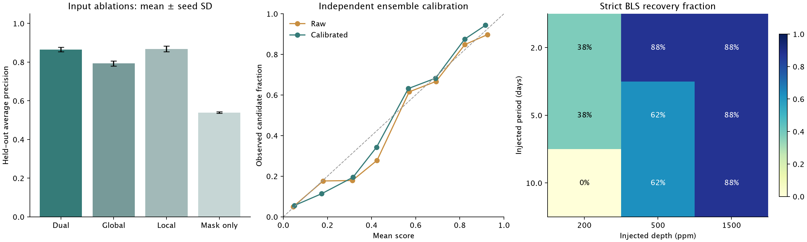

# Multi-quarter study results

3,273 usable stars with Q9 and Q10, from 4,000 requested. Every pilot star excluded.

## Cohort and partitions

Usable catalog counts: {'FALSE POSITIVE': 1748, 'CANDIDATE': 1525}. Selected counts: {'FALSE POSITIVE': 2228, 'CANDIDATE': 1772}.

Partitions: {'train': 1782, 'validation': 495, 'calibration': 505, 'test': 491}. Device: mps. All seeds share these star-disjoint partitions.

## Three-seed input ablations

| Mode | AP, mean ± seed SD | ROC AUC, mean ± seed SD | F1, mean ± seed SD |
|---|---:|---:|---:|
| dual | 0.8650 ± 0.0113 | 0.8983 ± 0.0052 | 0.8257 ± 0.0052 |
| global | 0.7932 ± 0.0134 | 0.8363 ± 0.0100 | 0.7610 ± 0.0049 |
| local | 0.8683 ± 0.0146 | 0.8901 ± 0.0035 | 0.8209 ± 0.0012 |
| mask | 0.5393 ± 0.0036 | 0.5737 ± 0.0107 | 0.6437 ± 0.0037 |

Same-cohort logistic baseline: test AP 0.7841, ROC AUC 0.8328. Its scaler and classifier fit training stars only.

Every seed result and model checkpoint is stored under `runs/research-q9-q10/`. Sample SD measures initialization variation, not population uncertainty. All modes retain identical network capacity.

## Ensemble calibration

| Score version | Test Brier | Test log loss | Test AP |
|---|---:|---:|---:|
| Raw | 0.1231 | 0.4105 | 0.8712 |
| Calibrated | 0.1241 | 0.4099 | 0.8712 |

Calibrator fitted on 505 separate calibration stars, candidate fraction 0.465. The ensemble averages all three predeclared dual-view seeds; no best seed is chosen.

Reliability refers to DR25 candidate labels in the eligible, available-quarter KOI cohort. Availability filtering and the period range restrict representativeness. These are not probabilities of physical planet confirmation.

## BLS injection/recovery

Strict recoveries: **44/72** (61.1%); harmonic matches: 1.

Uninjected backgrounds above depth SNR 7.1: **5/8**. This threshold is exploratory and does not establish a global false-alarm probability.

| Period (days) | Depth (ppm) | Strict recoveries | Fraction |
|---:|---:|---:|---:|
| 2 | 200 | 3/8 | 37.5% |
| 2 | 500 | 7/8 | 87.5% |
| 2 | 1500 | 7/8 | 87.5% |
| 5 | 200 | 3/8 | 37.5% |
| 5 | 500 | 5/8 | 62.5% |
| 5 | 1500 | 7/8 | 87.5% |
| 10 | 200 | 0/8 | 0.0% |
| 10 | 500 | 5/8 | 62.5% |
| 10 | 1500 | 7/8 | 87.5% |

Box injections on eight actual KOI backgrounds are a small detection experiment, not a population completeness measurement. No combined BLS+CNN discovery-performance claim is made.

## Reproduce and inspect

- [Study design, isolation rules and commands](RESEARCH_STUDY.md)
- [Data manifest](../data/research-q9-q10/manifest.json)
- [Predeclared training plan](../runs/research-q9-q10/plan.json)
- [Study summary](../runs/research-q9-q10/summary.json)
- [Ensemble predictions](../runs/research-q9-q10/ensemble-predictions.csv)
- [Every BLS trial](../runs/injection-recovery/trials.csv)
- [Uninjected controls](../runs/injection-recovery/nulls.csv)
- [Exportable figure (PDF)](figures/research-study.pdf)

After reviewing these held-out results, model changes guided by these errors require a new untouched test set. The original pilot remains separately available in the app.
